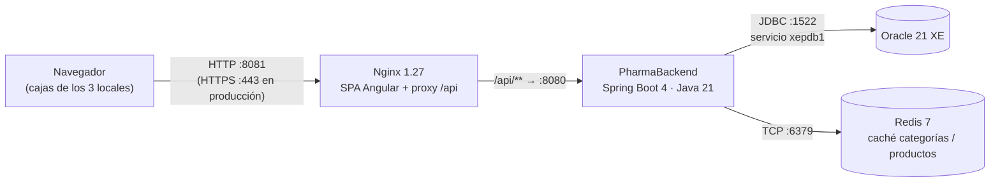

# PharmaBackend

API REST de PharmaSoft, el sistema de ventas de la botica. Construida con Spring Boot 4.0.7 y Java 21, usa Oracle como base de datos, Redis como caché, autenticación con JWT y monitoreo con Spring Boot Actuator.

## Ejecución en desarrollo

```bash
./mvnw spring-boot:run          # perfil dev por defecto
```

- API: `http://localhost:8080/api/v1`
- Swagger: `http://localhost:8080/swagger-ui.html`
- Salud: `http://localhost:8080/actuator/health`

Requiere Oracle en `localhost:1522/xepdb1` y Redis en `localhost:6379` (`docker compose up -d redis`).

## Despliegue en producción

### Arquitectura



| Pieza | Imagen / tecnología | Puerto | Expuesto a los locales |
|---|---|---|---|
| Nginx (SPA + proxy `/api`) | `nginx:1.27-alpine` | 8081 → 80 (443 con HTTPS) | Sí, es la única entrada |
| PharmaBackend | Spring Boot 4.0.7, Java 21 | 8080 | No, solo Nginx lo llama |
| Oracle | Oracle Database 21 XE | 1522 | No |
| Redis | `redis:7-alpine` | 6379 | No |

El navegador solo habla con Nginx. Al compartir el mismo origen, el API no necesita CORS y el backend, Oracle y Redis quedan en la red interna.

### Variables de entorno

Se leen en `application.yaml` y `application-prod.yaml`. **Nunca se escriben valores reales en el repositorio.**

| Variable | Obligatoria | Propósito | Ejemplo de formato (no real) |
|---|---|---|---|
| `SPRING_PROFILES_ACTIVE` | Sí | Activa el perfil de producción | `prod` |
| `SERVER_PORT` | No (8080) | Puerto HTTP del backend | `8080` |
| `DB_URL` | Sí | Cadena JDBC de Oracle | `jdbc:oracle:thin:@//<host>:1522/<servicio>` |
| `DB_USERNAME` | Sí | Usuario del esquema | `<usuario>` |
| `DB_PASSWORD` | Sí | Contraseña del esquema | `<secreto>` |
| `JWT_SECRET` | Sí | Clave de firma de los tokens, en Base64, mínimo 32 bytes | `<base64 de 48 bytes>` |
| `JWT_EXPIRACION_MINUTOS` | No (30) | Vigencia del token | `30` |
| `FRONTEND_ORIGINS` | Sí | Orígenes permitidos por CORS | `https://pharmasoft.<dominio>` |
| `REDIS_HOST` | No (localhost) | Servidor Redis | `redis` |
| `REDIS_PORT` | No (6379) | Puerto de Redis | `6379` |

Para generar una clave JWT: `openssl rand -base64 48`.

En el perfil `prod`: `ddl-auto: validate` (Hibernate no altera las tablas), Swagger deshabilitado, sin SQL en el log y log en `logs/pharma-backend.log` con rotación de 10 MB y 14 archivos.

### Construir y desplegar

```bash
# 1. Etiquetar la versión que se va a desplegar
git checkout main && git pull
git tag v1.3.0 && git push origin v1.3.0

# 2. Construir el JAR (ejecuta las pruebas)
./mvnw clean package

# 3. Conservar la versión anterior para poder volver
cp /opt/pharmasoft/pharma-backend.jar /opt/pharmasoft/pharma-backend.prev.jar

# 4. Copiar el nuevo JAR y reiniciar el servicio con las variables de entorno
cp target/PharmaBackend-*.jar /opt/pharmasoft/pharma-backend.jar
sudo systemctl restart pharma-backend      # o: docker compose up -d --build backend

# 5. Verificar
curl -i http://localhost:8080/actuator/health          # 200 {"status":"UP"}
```

Redis no se reinicia en un despliegue del backend: las claves sobreviven y la caché no se enfría. Si el despliegue cambió la forma de los DTO en caché, hay que vaciarla con `redis-cli FLUSHDB`.

### Volver a la versión anterior

```bash
cp /opt/pharmasoft/pharma-backend.prev.jar /opt/pharmasoft/pharma-backend.jar
sudo systemctl restart pharma-backend
redis-cli FLUSHDB                               # evita DTO en caché con formato nuevo
curl -i http://localhost:8080/actuator/health   # confirmar UP
```

Con `ddl-auto: validate`, los cambios de esquema se aplican con scripts SQL versionados que deben tener su script de reversión. Antes de cada despliegue se hace una copia de seguridad de Oracle.

### Estado de las buenas prácticas

| Buena práctica | Estado | Evidencia / acción pendiente |
|---|---|---|
| Features con carga diferida y `@defer` | ✅ Cumple | Rutas `loadChildren` y bloques `@defer` (Parte A) |
| Archivos con hash: `max-age=31536000, immutable` | ✅ Cumple | `curl -I` de `main`, chunks y `styles` (Parte B) |
| `index.html` con `no-cache` | ✅ Cumple | Un despliegue se ve sin borrar la caché (Parte B) |
| API sin caché en el navegador | ✅ Cumple | Spring Security envía `no-cache, no-store` (Parte B) |
| Compresión gzip | ✅ Cumple | `Content-Encoding: gzip` en las respuestas |
| Caché Redis con TTL e invalidación | ✅ Cumple | 95 % de aciertos, TTL 10 min, matriz C-01 a C-06 sin defectos |
| La app funciona si Redis cae | ✅ Cumple | C-06: la SPA sigue operando y health reporta DOWN |
| `X-Request-Id` en cada petición y en el log | ✅ Cumple | Venta reconstruida con `grep` (Parte D) |
| `requestId` en las respuestas de error | ✅ Cumple | `ErrorResponseDTO.requestId` y mensaje en la SPA |
| Sin secretos en el log | ✅ Cumple | Auditoría sin contraseñas, tokens, clave JWT ni DNI |
| Secretos por variables de entorno | ✅ Cumple | `application-prod.yaml` usa `${...}` |
| Health con detalle solo para el administrador | ✅ Cumple | `show-details: when-authorized` |
| Rotación del log | ✅ Cumple | 10 MB × 14 archivos en `prod` |
| `ddl-auto: validate` y Swagger apagado en producción | ✅ Cumple | `application-prod.yaml` |
| `spring.jpa.open-in-view` desactivado | ⚠️ Parcial | Spring advierte que está activo. **Acción:** `open-in-view: false` en `prod` |
| HTTPS | ❌ No cumple | **Acción:** certificado en Nginx (443) y redirección 80 → 443 |
| Redis con contraseña y sin puerto expuesto | ❌ No cumple | **Acción:** `requirepass` y quitar la publicación de `6379` |
| Copias de seguridad de Oracle | ❌ No cumple | **Acción:** `expdp` diario y prueba de restauración mensual |
| Alertas sobre `/actuator/health` | ❌ No cumple | **Acción:** monitor que avise ante un `503` |

### Recomendaciones para los tres locales

1. **HTTPS y un único servidor central (prioridad alta).** Instalar Nginx, el backend, Oracle y **un solo Redis compartido** en un servidor central, y que los tres locales entren por `https://`. Con un solo Redis, cuando un local cambia un precio o registra una venta, la invalidación se ve en los tres. Con un Redis por local, cada uno mostraría datos distintos hasta que venza el TTL. Por HTTPS viajan las contraseñas y el token JWT, así que nunca deben ir en texto plano por la red entre locales.
2. **Copias de seguridad de Oracle (prioridad alta).** Las ventas y el stock de los tres locales viven solo en Oracle; Redis es descartable. Hacer un `expdp` diario fuera del servidor, conservar al menos 7 días y probar la restauración una vez al mes. Hacer también una copia antes de cada despliegue.
3. **Alertas sobre `/actuator/health` (prioridad media).** Un monitor (Uptime Kuma, cron con `curl`) que consulte el health cada minuto y avise por correo o WhatsApp ante un `503`. En la prueba C-06, Redis cayó y los usuarios no lo notaron: sin alerta, nadie se habría enterado. Revisar además `http.server.requests` de `/api/v1/ventas` para detectar errores 5xx o tiempos altos.